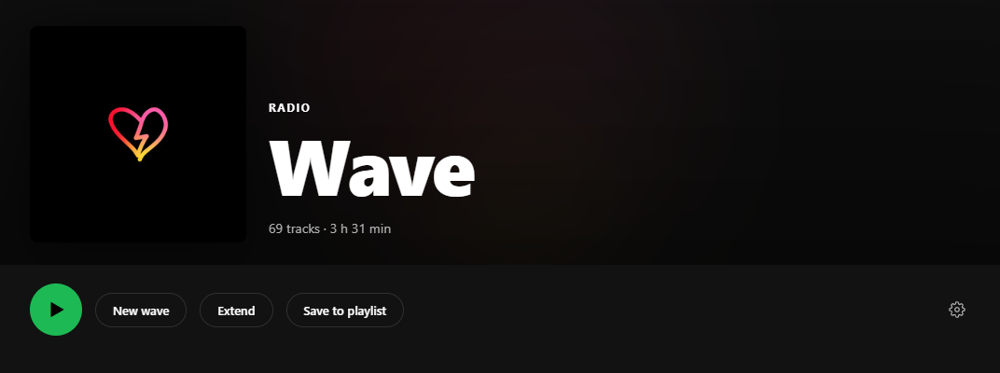

# spotwave

**Endless personal radio inside Spotify — a replacement for Yandex Music's “My Wave”.**

Runs as a [Spicetify](https://spicetify.app) custom app and uses the Spotify client's own
session. No API keys, no OAuth apps, no Premium-only Web API.

[](https://github.com/WhyTunesWorkspace/spotwave/releases)
[](LICENSE)
[](https://github.com/WhyTunesWorkspace/spotwave)
[](https://github.com/spicetify/marketplace)



> **Русская версия:** [README.ru.md](README.ru.md)

---

## Why

Spotify's own **daylist** ignores most of what you actually listen to, and the Web API has been
closed to new apps since February 2026 (Premium required for the app owner, extended quota for
companies only). So spotwave talks to the same internal endpoints the Spotify UI already uses —
playlist recommendations, GraphQL metadata, BPM/key decoration — and turns them into a proper
personal radio with skip learning.

## Features

| | |
|---|---|
| **My mix** | a wave built from your liked songs |
| **Playlist waves** | pick one playlist for its mood, or several for a mix |
| **Track / artist / album waves** | right-click a track, an artist or an album → wave in its spirit |
| **Only new** | excludes tracks from your playlists, liked songs and recent plays (URI + “title + artist” matching) |
| **Mood presets** | Calm / Sad / Mid / Energetic, plus Slow / Focus / Fast in advanced mode — filtered by BPM (Sad also prefers minor keys) |
| **Morning wave** | a scheduled calm wave: at the set time the app shows a "build it?" button (nothing autoplays) |
| **Simple / Advanced settings** | two modes of the settings panel: essentials by default, every knob in advanced |
| **Auto-extend** | adds more tracks as the wave runs out |
| **Skip learning** | a background extension records plays and skips even when the tab is closed |
| **Manual feedback** | like (adds to Liked Songs), hide track for 45 days, mute artist |
| **Pick reason** | every track shows where it came from |
| **Stats** | plays, skips, completion, top artists, weekday/hour distribution, average tempo |
| **Scrobbling** | optional ListenBrainz export |
| **Playlist export** | “Save to playlist” creates a snapshot that syncs to your phone |
| **Profile backup** | export/import the learned taste profile and settings as JSON |

## Requirements

- Spotify desktop (not the Microsoft Store build)
- [Spicetify CLI](https://spicetify.app) ≥ 2.40
- Windows 10/11, macOS or Linux
- [SpotX](https://github.com/SpotX-Official/SpotX) is optional but recommended on free accounts
  (Spotify and Spicetify live together fine: SpotX first, then Spicetify)

## Install

### Spicetify Marketplace

Open **Marketplace → Apps**, find **spotwave**, and open its card. Marketplace lists custom
apps and links to their repo — apps are installed with the script below, not inside the card.

### Windows (one line)

```powershell
iwr -useb https://raw.githubusercontent.com/WhyTunesWorkspace/spotwave/main/scripts/install.ps1 | iex
```

The script finds Spotify and Spicetify, copies the app, sets `custom_apps = wave`, backs up
`xpui.spa` and applies the patch. Run PowerShell as your normal user (not elevated) to avoid a
black window.

### macOS / Linux

```bash
curl -fsSL https://raw.githubusercontent.com/WhyTunesWorkspace/spotwave/main/scripts/install.sh | bash
```

### From source

```bash
git clone https://github.com/WhyTunesWorkspace/spotwave.git
cd spotwave
# Windows
powershell -ExecutionPolicy Bypass -File .\scripts\install.ps1
# macOS / Linux
bash scripts/install.sh
```

### First run

1. Open Spotify → a **round wave icon** appears in the top-left corner (next to back/forward).
2. Open it, pick sources, hit **Build wave**.
3. The first run takes a few seconds while spotwave collects your known tracks.

The app UI is available in **Russian and English** (auto-detected from the client locale,
switchable in Settings).

## Usage

### Sources

- **My mix** — Spotify recommendations seeded by your liked songs.
- **Playlists** — select one or several; the recommendation engine follows their mood.
- **Right-click a playlist → “Wave from this playlist”**.
- **Right-click a track → “Wave from this track”**, **right-click an artist → “Wave by this artist”**.
  A temporary `Волна · Seed` playlist is filled with the seed tracks and reused on the next seed.

### Settings

| Setting | What it does |
|---|---|
| Novelty | how willingly unknown artists are picked |
| Diversity | max tracks per artist in one wave |
| Length | tracks generated per run |
| Exploration | amount of randomness |
| Only new | exclude liked/playlists/recently played |
| Mood | BPM filter: calm / sad / mid / energetic / any, plus slow / focus / fast in advanced mode |
| Morning wave | schedule a calm wave; at that time a "build it?" button appears, nothing autoplays |
| Simple / Advanced | switch the settings panel between essentials and every knob |
| Auto-extend | top up the queue when the wave ends |
| Language | auto / Russian / English |

### Playback

The wave is written into a service playlist **`Волна · Live`** and played as a playlist context —
so native ⏭/⏮, the queue and shuffle all work. The playlist is visible in your library and on
your phone.

## How it works

```
app/
  index.js       UI (React via Spicetify) + recommendation engine
  extension.js   background tracker, context-menu items, scrobbling
  style.css
  manifest.json
```

- **Candidates** — `PlaylistAPI.getRecommendedTracks(contextUri, skipIds, limit, {decorateWithBpmAndKey:true})`,
  the same engine Spotify uses for playlist enhancements. Liked songs act as a playlist context.
  The client returns **BPM and key** along with tracks, which replaces the closed audio features.
- **Filters** — bans, “only new”, mood BPM range, long tracks, slowed/remix/karaoke.
- **Ranking** — artist affinity (completions + likes − skips) × freshness × novelty + exploration noise.
- **Selection** — greedy pick with a per-artist cap and no back-to-back repeats.
- **Reason** — each track keeps its source (`from «Melancholy»`, `from your liked songs`, …).
- **Playback** — rewrite `Волна · Live`, then `playUri` as a context.
- **Auto-extend** — when 3–4 tracks remain, generate more, update the playlist, enqueue the rest.

State lives in `localStorage`: `wave.v1` (settings, profile, history), `wave.events` (raw plays),
`wave.known.v2` (known-track cache, 6 h TTL).

## Troubleshooting

| Symptom | Fix |
|---|---|
| No wave icon | run `spicetify apply` with Spotify closed; check `custom_apps = wave` |
| Black window after patching | don't run Spicetify as administrator (or use `--bypass-admin` if you must) |
| Empty wave | turn off “Only new”, add playlists, check your connection |
| Next/prev does nothing | make sure `Волна · Live` is the playing context |
| Everything broke after a Spotify update | `spicetify restore`, then run the installer again |

Logs: `Ctrl+Shift+I` → Console, filter `[wave]`.

## Limitations

- No Spotify audio features (closed); “energy” is approximated by BPM.
- Recommendations work by playlist context; track/artist seeds use a temporary playlist.
- Scrobbling supports ListenBrainz (Last.fm needs a separate OAuth session).
- A client modification can break after major Spotify updates.

## Uninstall

```powershell
spicetify config custom_apps ""
spicetify apply
# full Spicetify rollback:
spicetify restore
```

App data: remove `wave.*` keys from localStorage (DevTools → Application).

## Contributing

Issues and PRs are welcome. The app is plain ES5-ish JS without a build step —
`node --check app/index.js` plus a manual run in the client is enough for most changes.
See [CONTRIBUTING.md](CONTRIBUTING.md).

## Roadmap

- [x] Playlist / track / artist / album waves
- [x] Skip learning, mood presets, auto-extend
- [x] Morning wave on a schedule (prompt, not autoplay)
- [x] Simple / Advanced settings modes
- [x] Bilingual UI, native redesign, brand identity
- [x] Spicetify Marketplace listing
- [ ] Shared presets and community mood packs
- [ ] Optional local server for generating from a phone

## Brand


The mark is a **W built from a waveform** — one stroke, three peaks, two valleys, still legible
at 24 px. Palette: mint `#2BE5A6`, deep `#0E7A52`, ink `#08080A`, paper `#F2F2F2`,
blood `#C1121F`.

Assets, clear space and usage rules: [docs/brand/brand.md](docs/brand/brand.md).

## License

MIT — see [LICENSE](LICENSE).

> Personal, non-commercial project. It uses your own client session only and sends nothing
> anywhere except the optional ListenBrainz scrobbles. Note that Spicetify and SpotX are
> third-party client modifications and formally diverge from Spotify's ToS.
